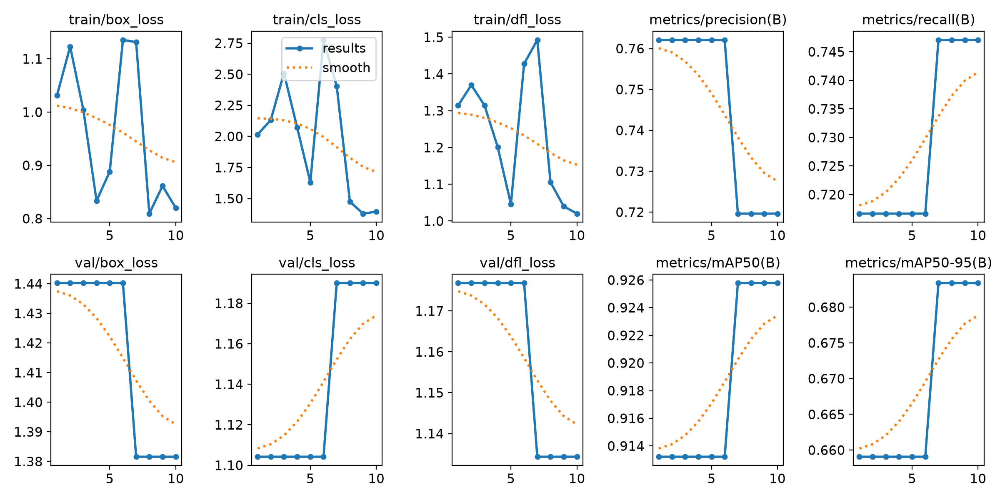
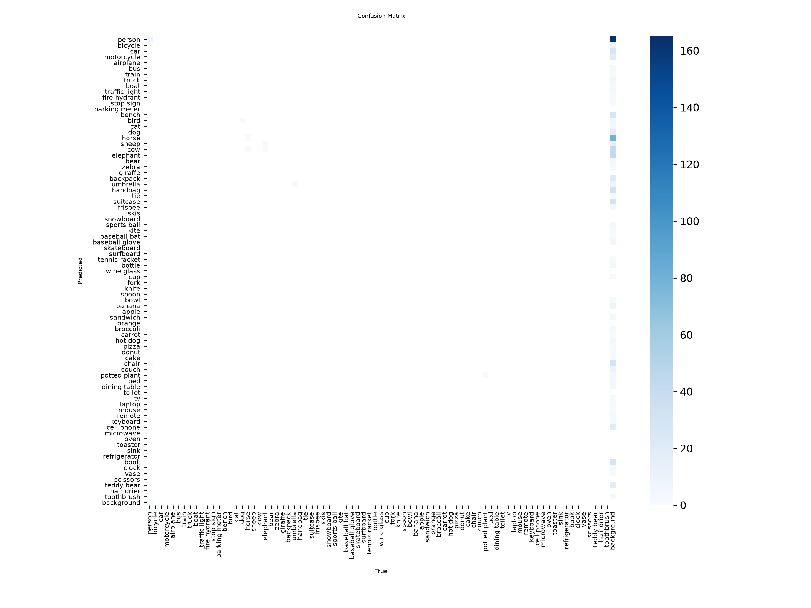

# LAB 10: Object Detection Using YOLO

---

##  ภาพรวมโครงการ (Project Overview)
รายงานและบันทึกผลการปฏิบัติการชิ้นนี้เป็นการศึกษาและประยุกต์ใช้อัลกอริทึม **YOLO (You Only Look Once) เวอร์ชัน 8** สำหรับงานด้าน **Object Detection** (การตรวจจับ จำแนกประเภท และระบุตำแหน่งวัตถุภายในภาพ) โดยครอบคลุมตั้งแต่กระบวนการเตรียมชุดข้อมูล การฝึกสอน (Training) การประเมินประสิทธิภาพ (Evaluation) ตลอดจนการนำโมเดลไปทดสอบทำนายผลกับภาพจริง

---

##  โครงสร้างโปรเจกต์ (Project Structure)
- `train.py` : สคริปต์สำหรับโหลด Pretrained Model (`yolov8n.pt`) และควบคุมกระบวนการ Train โมเดล YOLOv8
- `evaluate.py` : สคริปต์ประเมินผลประสิทธิภาพของโมเดลเพื่อคำนวณค่าสำคัญ เช่น Precision, Recall และ mAP
- `predict.py` : สคริปต์สำหรับการนำโมเดลที่ดีที่สุดมาทดสอบตีกรอบวัตถบบนรูปภาพ (Inference)
- `runs/detect/` : โฟลเดอร์ที่ระบบบันทึกผลการทดลอง รวมถึงน้ำหนักของโมเดล (`best.pt`) และกราฟประเมินผล

---

## สถาปัตยกรรมและการฝึกสอน (Experimental Setup)
- **Model:** YOLOv8n (Nano - ขนาดเล็ก น้ำหนักเบา เหมาะสำหรับการประมวลผลที่รวดเร็ว)
- **Dataset:** COCO8 (ชุดข้อมูลมาตรฐานสำหรับการทดสอบระบบ Object Detection)
- **Hyperparameters:**
  - จำนวนรอบในการฝึกสอน (`epochs`): 10 รอบ
  - ขนาดกลุ่มข้อมูลต่อรอบ (`batch`): 8
  - ขนาดภาพอินพุต (`imgsz`): $480 \times 480$ พิกเซล

---

##  ผลการทดลองและประเมินผล (Experimental Results)

### 1. กราฟสรุปผลการฝึกสอน (Training & Validation Results)
กราฟแสดงแนวโน้มของค่าความสูญเสีย (Loss) ทั้งในส่วนของ Box Loss, Class Loss และค่าความแม่นยำ (mAP) ตลอดระยะเวลา 10 Epochs:

### 2. เมทริกซ์ความสับสน (Confusion Matrix)
แสดงประสิทธิภาพการจำแนกประเภทวัตถุของโมเดลในแต่ละคลาส:

### 3. ผลการตรวจจับวัตถุ (Object Detection Predictions)
ตัวอย่างการทดสอบโมเดลในการตีกรอบ (Bounding Boxes) และระบุระดับความมั่นใจ (Confidence Score) บนภาพทดสอบ:

